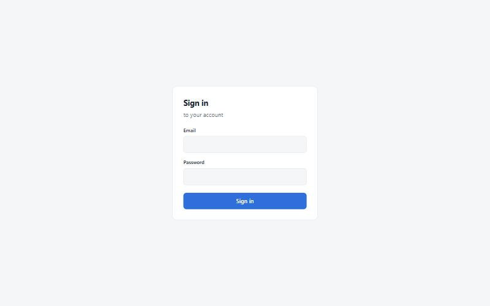
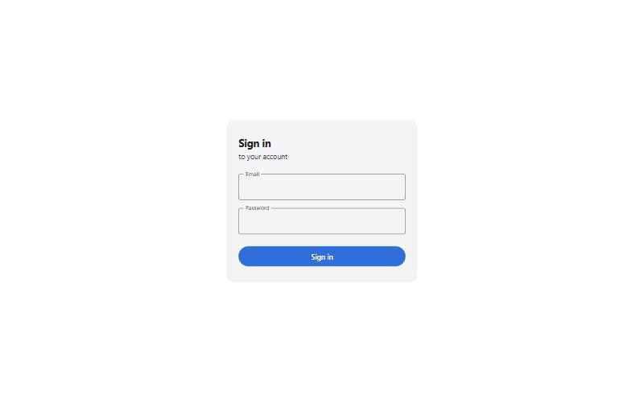
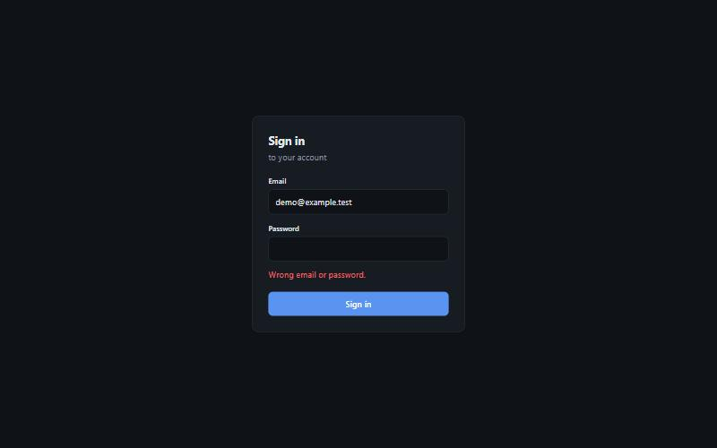
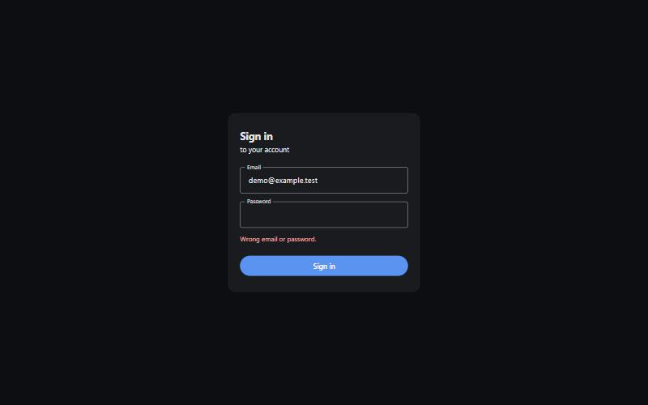

# Refactor to the shared template (branch refactor/template, 2026-10-29)

## Screens
| | Before | After |
|---|---|---|
| Sign-in, light |  |  |
| Wrong password, dark |  |  |

**Visual changes (intentional):**
- The pages use the shared dashboard theme's tokens and colors, in `idp/idp/static/theme.css`. It's a plain-CSS copy of the values the Angular theme resolves to.
- Material 3 styling: outlined text fields with the label on the border, a pill-shaped filled button, Material surfaces.
- Light and dark still follow the system.

## What changed and what didn't
- **Still Flask, not FastAPI.** Authlib's OAuth 2 / OpenID Connect *server* integrates with Flask and Django only. Rewriting the provider on FastAPI would mean re-implementing the protocol code, which is the riskiest part to hand-roll. The layout stays small: `models.py`, `oauth.py` (the grant), `routes.py`, `clients.py`, `cli.py`.
- **Tests:** `idp/tests/test_idp.py` (pytest, Flask test client, SQLite in a temp dir) covers:
  - discovery and JWKS
  - frame-ancestors and CORS
  - PKCE required
  - wrong password
  - the full public-client code flow, with the ID token verified
  - nonce replay
  - logout redirects
- **Fix found by the tests:** a nonce could be replayed once its code had been exchanged, because the code row is deleted at exchange. Exchanged nonces are now kept for a day in `used_nonce`. The table is created at start; no manual step.
- `ruff` (lint + format) in `idp/pyproject.toml`; dev deps in `idp/requirements-dev.txt`.
